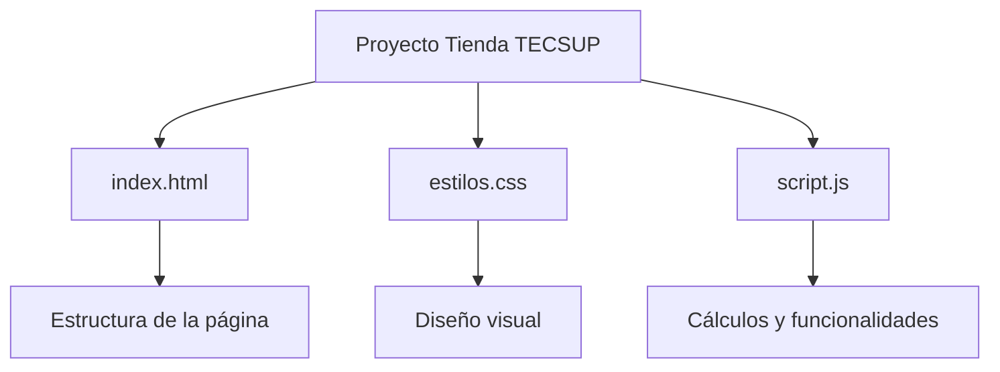

# Tienda TECSUP


Proyecto de práctica del Laboratorio 03 del curso Diseño de Interfaces de Programación Avanzado.
Se utiliza para aprender a trabajar con Git y GitHub mediante Issues, ramas y Pull Requests.

## Índice

- [Descripción](#descripción)
- [Tecnologías utilizadas](#tecnologías-utilizadas)
- [Instalación](#instalación)
- [Uso](#uso)
- [Resultado esperado](#resultado-esperado)
- [Arquitectura del proyecto](#arquitectura-del-proyecto)
- [Estado del proyecto](#estado-del-proyecto)
- [Contribuciones](#contribuciones)

## Descripción

Tienda TECSUP es una página web utilizada para practicar la colaboración en proyectos de software.
Durante el laboratorio se trabajó en la identificación y corrección de errores utilizando GitHub.

## Tecnologías utilizadas

| Tecnología | Uso |
|:---|:---|
| HTML | Estructura de la página |
| CSS | Diseño y estilos |
| JavaScript | Cálculos y funcionalidades |
| Git | Control de versiones |
| GitHub | Issues y Pull Requests |

## Instalación

1. Clonar el repositorio:

```bash
git clone https://github.com/aldayrgavidia-dev/tienda.git
```

2. Entrar a la carpeta:

```bash
cd tienda
```

## Uso

Abrir el archivo `index.html` en un navegador web para visualizar la tienda.

También se puede utilizar Visual Studio Code para revisar y modificar los archivos del proyecto.

Ejemplo de código JavaScript:

```javascript
function calcularTotal(precio, cantidad) {
    return precio * cantidad;
}
```

## Resultado esperado

Al abrir la página, se debe visualizar correctamente el diseño y mostrar:

```text
Total: S/ 68.00
```


## Arquitectura del proyecto




## Estado del proyecto

| Elemento | Estado |
|:---|:---:|
| Estructura HTML | Completado |
| Estilos CSS | Completado |
| Funcionalidades JavaScript | Completado |
| Documentación profesional | En desarrollo |

## Hoja de ruta

- [x] Crear el repositorio mediante Fork.
- [x] Identificar errores utilizando Issues.
- [x] Proponer correcciones mediante Pull Requests.
- [ ] Mejorar la documentación del proyecto.
- [ ] Mantener actualizado el repositorio.

## Contribuciones

Si deseas reportar un error o proponer una mejora, revisa nuestra guía:

[Leer CONTRIBUTING.md](CONTRIBUTING.md)
